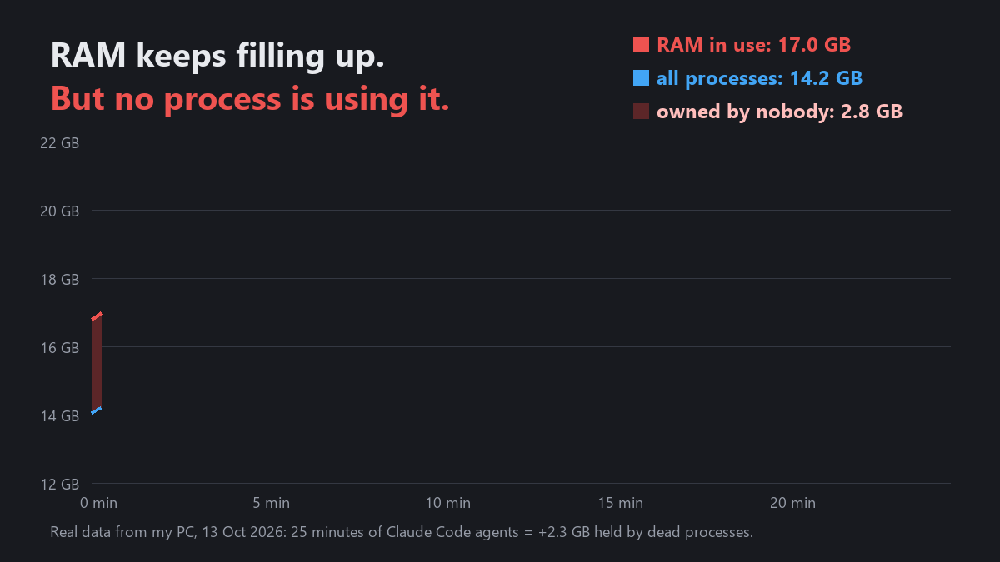
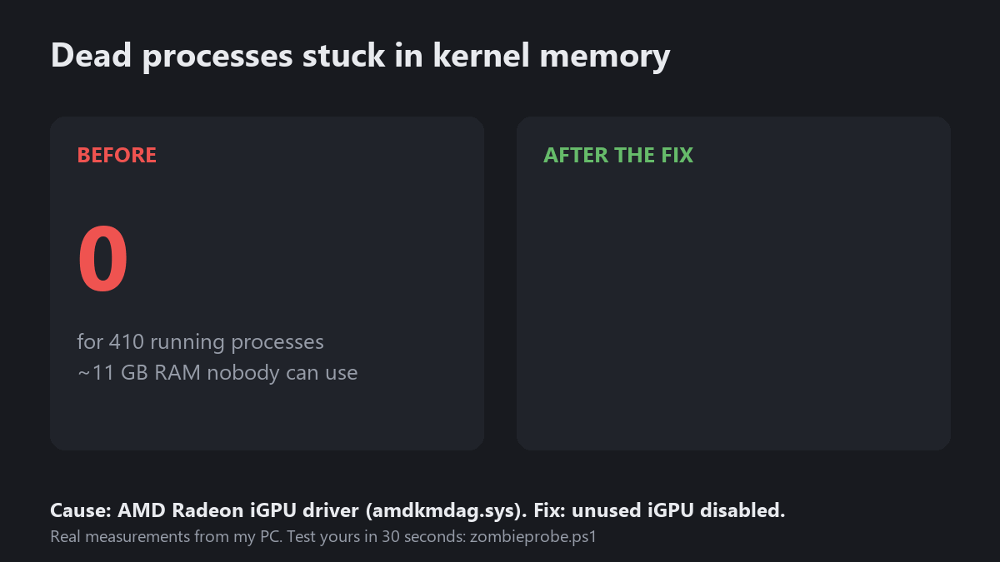

# claude-code-zombies 🧟

**Is your RAM filling up while Claude Code (or Cursor, Codex, any coding agent) runs on Windows, and Task Manager shows no process using it?**
You may have a driver that keeps every exited process in kernel memory. This repo has a 30-second test and the tools to find the driver.



## The 30-second test

Download `zombieprobe.ps1` (or clone the repo) and run in PowerShell:

```powershell
powershell -ExecutionPolicy Bypass -File .\zombieprobe.ps1
```

It starts 50 tiny processes (`cmd /c exit`), closes every handle, and checks whether Windows actually freed them.

| Result | Meaning |
|---|---|
| `RESULT: OK` | Exited processes are freed normally. This leak is not your problem. |
| `RESULT: LEAK` | Windows keeps exited processes in kernel memory on this PC. Keep reading. |

Run it as administrator to also see the system-wide count (for example `171,234 process objects for 410 running processes`).

## What is going on

Every process that ends should disappear from kernel memory once nobody holds a reference to it. Some kernel drivers take a reference on **every** process and never release it. Each exited process then stays as a "zombie" process object, about 50–100 KB with its page tables, **until you reboot**.

- **Task Manager** shows the memory as *in use*, but no process owns it.
- **Process Explorer / handle tools** find nothing either, because no program holds a handle.
- **RAMMap** shows it as growing *Page Table* memory.

On a normal PC this leak is small. **Coding agents make it 100× worse.** Every tool call starts a whole chain of short-lived processes: the shell, `conhost`, `git`, plus every hook you have configured. On my PC that was **275–575 process starts per minute** while agents were working, about **1–2 GB of RAM lost per hour**. My 32 GB machine was full after 2–3 hours.

## How I found the cause

1. **Probe:** 50 of 50 test processes stayed as zombies. The system-wide count was 171,000 process objects for 410 running processes.
2. **Safe Mode:** the same probe gave **0 of 50**. So Windows itself was fine and a driver that loads only in normal mode was holding them.
3. **Bisect:** I switched off groups of third-party drivers (VPNs, network filters, cloud drives, hardware tools) and re-tested. All innocent.
4. **Device test:** I disabled the **AMD Radeon integrated GPU** (driver `amdkmdag.sys` 31.0.24002.92), which wasn't even driving a monitor; the screen runs on an NVIDIA card. The result was **0 of 50** immediately, and the zombie count stopped growing (it had been +575 per minute).
5. **Fix:** I kept the unused iGPU disabled. In 8 days of logs since then the maximum has been 229 zombies, and the RAM stays free.



**On your PC it can be a different driver.** The tools below find it.

## Find your driver

All commands need an **elevated PowerShell** (Run as administrator) except `test`.

```powershell
.\zombieprobe.ps1 scan              # third-party kernel drivers + devices, flags known culprits
.\zombieprobe.ps1 hunt              # finds a guilty DEVICE driver, no reboot needed
.\zombieprobe.ps1 bisect start      # finds a guilty NON-device driver (VPN, filter, ...) via reboots
.\zombieprobe.ps1 bisect continue   # run after each reboot
.\zombieprobe.ps1 restore           # undo everything hunt/bisect changed
.\zombieprobe.ps1 report            # writes zombieprobe-report.md for an issue
```

**`hunt`** switches off one third-party device at a time: GPU, audio, network, Bluetooth, camera and similar. Each device is off for about 15 seconds while the probe runs, then comes back on. It asks before every device, and it never touches the GPU that drives your monitor, your active network connection, disks, keyboard or mouse.

**`bisect`** handles drivers that don't belong to a device, such as VPN, firewall, RGB, cloud drive and anti-virus filter drivers. It switches off half of the candidates for the next boot, you reboot, and `bisect continue` tests and narrows it down. With 8 candidates that takes about 4 reboots. Boot-critical, storage and encryption drivers are never touched. Everything is restored at the end or with `restore`, and a restore point is created first if System Protection is on.

Add `-DryRun` to `hunt` or `bisect start` to see the candidates without changing anything.

### Still not found?

- Check Safe Mode yourself: Shift + Restart → Troubleshoot → Advanced options → Startup Settings → **4**. Then run `zombieprobe.ps1`. If you get **0** in Safe Mode, a driver or service is the cause; if you get **50**, it's Windows itself, so install the pending updates.
- Microsoft components that don't run in Safe Mode, such as Hyper-V/VBS (used by Docker and WSL2). Test with `bcdedit /set hypervisorlaunchtype off`, reboot, test, then `bcdedit /set hypervisorlaunchtype auto`.
- User-mode services: do a clean boot with `msconfig` → Services → "Hide all Microsoft services" → Disable all, reboot, test.

## Known culprits

| Driver | Vendor / device | Version | Fix |
|---|---|---|---|
| `amdkmdag.sys` | AMD Radeon integrated graphics (Ryzen iGPU) | 31.0.24002.92 | disable the unused iGPU, or update the AMD driver and re-test |

`scan` checks your drivers against [`known-culprits.json`](known-culprits.json). **Found yours?** Run `.\zombieprobe.ps1 report` and open an issue, so the next person finds it in 30 seconds.

## Less RAM loss while you hunt

Every hook in `~/.claude/settings.json` runs on every matching event, and each one starts at least one process. Hooks that fire on `PreToolUse`/`PostToolUse` multiply fastest. Removing hooks you don't need cuts the leak rate until the driver is fixed. A reboot frees everything that has leaked so far.

## FAQ

**Is this a Claude Code bug?** No. Claude Code just starts many short processes, which is normal. The leak is in a driver. Claude Code makes it visible because it runs so many processes.

**Is the test safe?** `test`, `scan` and `report` only read. `hunt` and `bisect` change device and driver settings, always with an undo (`restore`).

**Windows 11?** Yes. Windows 10 and 11 with PowerShell 5.1 or newer.

## License

MIT
